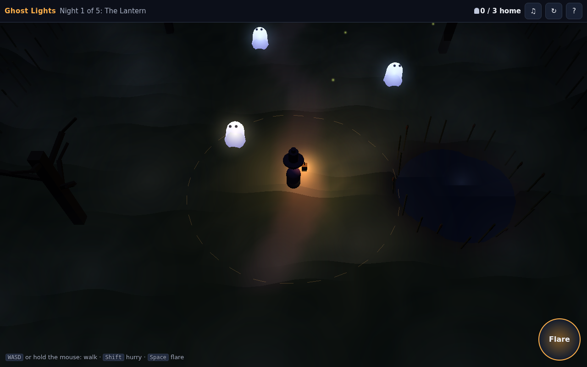

# Ghost Lights

**Play it in a browser: https://ghost-lights.play.danielstephenson.dev** (desktop and phone)



_The first night, from the browser build's smoke test (headless Chromium, software WebGL)._

Lost little ghosts drift across a foggy marsh on Halloween night. You carry a lantern, and ghosts that come near
its light follow you. Lead them home to the cottage, and on the last night through the churchyard gate.

It is a calm, small puzzle: five short nights of about a minute or two each.

- **Walk softly.** Hurrying frightens the ghosts in your light, and they scatter.
- **Fog banks** swallow the light: inside one, the lantern reaches only half as far.
- **Will-o'-the-wisps** lure ghosts away. Flare the lantern to chase them off and call the ghosts back. The flare
  takes a few seconds to come back.

The faint ring on the ground shows how far your light reaches.

## Controls

| | Keyboard and mouse | Touch |
|---|---|---|
| Walk | <kbd>W</kbd><kbd>A</kbd><kbd>S</kbd><kbd>D</kbd> or the arrow keys, or hold the mouse button where you want to go | Drag anywhere (a stick appears under your finger) |
| Hurry | <kbd>Shift</kbd> | Push the stick all the way out |
| Flare | <kbd>Space</kbd> | The **Flare** button |
| Start the night again | <kbd>R</kbd> or &#8635; | &#8635; |
| Sound | <kbd>M</kbd> or &#9835; | &#9835; |

Every sound is synthesised in the page with Web Audio (wind, frogs, crickets, bells); there are no recordings.

## How it is made

- `src/sim/`: the rules, with no engine: the marsh, the ghosts' states (idle, following, scared, lured, going
  home), the wisps, the five levels as data, and a patient autopilot. The world steps at a fixed 1/60 s.
- `src/play/`: the marsh drawn on [Strata](https://github.com/Preponderous-Software/strata) v0.7.0: a terrain
  tile, static meshes for the ponds, reeds, trees and buildings, translucent unlit ghosts, point lights for the
  lantern, the ghosts and the wisps, and soft point overlays for the fog, which the lantern lights warm.
- `app/web_main.cpp` and `web/shell.html`: the browser build (Emscripten, WebGL 2) behind the Strata web kit's
  loading shell (`web/strata-kit`, vendored at a pinned Strata commit). The page owns the controls, the cards
  and the sound.

### Build and test

The rules and their tests need only a C++17 compiler and CMake 3.20 or newer:

```sh
cmake -S . -B build && cmake --build build && ctest --test-dir build --output-on-failure
```

The tests check following, scattering, fog, wisps, the flare and home, and that the autopilot brings every
ghost home on all five nights without frightening one.

The browser game needs emsdk 6.0.11 (Strata's pin):

```sh
emcmake cmake -S . -B build-web -DGHOST_WEB=ON && cmake --build build-web
# serve build-web/ghost-lights.html (as index.html) with ghost-lights.js and ghost-lights.wasm
node web/smoke/smoke.cjs http://127.0.0.1:8080/ smoke-out/desktop          # and --phone
```

CI (`.github/workflows/browser.yml`) builds the page, runs the tests as wasm under Node, smoke-tests the page in
headless Chromium on a desktop and an iPhone 13 profile, and deploys `main` to the arcade.

## Licence

MIT; see [LICENSE](LICENSE). Strata and its web kit are MIT as well (`web/strata-kit/LICENSE`).

_drafted by Claude on behalf of Daniel Stephenson_
